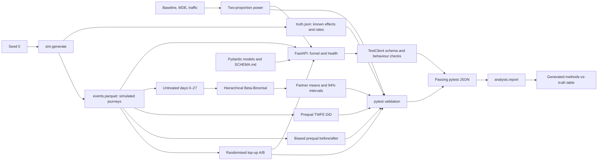
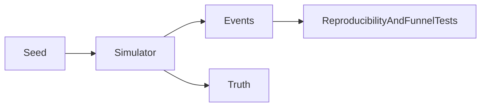
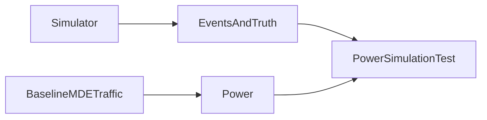
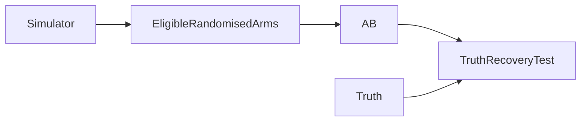
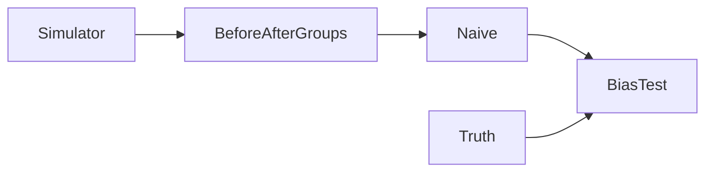

# Architecture and Git checkpoints

Work stays on one branch (`main`); nothing is pushed. Each completed step is
tested before its checkpoint commit. This diagram is updated in subsequent
checkpoints, so Git preserves the architecture alongside the implementation.
The first four snapshots below record the checkpoints already completed when
Leo requested architecture history.

## Current architecture

## Earlier checkpoint snapshots

The GOAL continuation completed the hierarchy, API, test and report stages,
but its commit attempts were blocked by the session approval policy. Those
green checkpoints are recorded in `NOTES.md`; they have no commit IDs yet.

`b02e8ee` — simulator; two tests passed.

`c832b3d` — power; ten cumulative tests passed.

`5b0422b` — A/B; eight focused tests passed.

`57c6ea4` — naive benchmark; two focused tests passed.

## Inspecting or undoing a checkpoint

Use `git log --oneline` to locate checkpoints and `git show <commit>` to inspect
them. A later, explicitly chosen `git revert <commit>` can undo a change with a
new commit while preserving history. No rollback is performed automatically.
`uv.lock` pins dependencies; generated `data/` files and virtual environments
are not versioned. Regenerate seed-0 data after restoring code, and sync the
environment from the restored lockfile. The original Python 3.11 environment
is preserved in ignored `.venv-python311/`.
